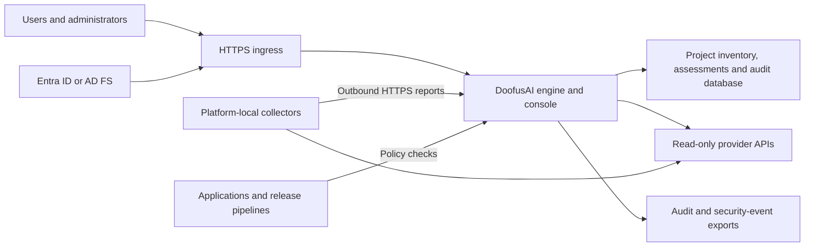

# DoofusAI SPM v4

**Authored by Aniza Inc.**

DoofusAI Security Posture Management gives security, cloud, and AI operations teams a project-based workspace for examining the configuration and relationships of AI infrastructure. It collects inventory from selected cloud and VMware services, assesses supported controls, explains findings using source evidence, and tracks remediation over time.

The current product is **v4**, implemented in Python with a browser console and SQLite persistence. Collection connectors can run on the central server or on additional platform-local agents. Both collection paths feed the same inventory, assessment, and reporting workflows.

[Client deployment package](https://github.com/sjanizacorp/doofusaiapm/releases/download/v4-client-2026-11-18/doofusai-spm-v4-client.zip) · [Narrated demo](https://github.com/sjanizacorp/doofusaiapm/releases/download/v4-client-2026-11-18/doofusai-spm-v4-demo.mp4) · [Release and checksums](https://github.com/sjanizacorp/doofusaiapm/releases/tag/v4-client-2026-11-18)

## What teams use it for

- **Inventory and configuration reviews.** Find supported models, endpoints, agents, identities, data stores, and workload relationships, then examine their reported settings.
- **AI security investigations.** Follow discovered configuration relationships between services, execution identities, model artifacts, and data. Review sensitivity and selected provider access decisions alongside exposure evidence.
- **Remediation tracking.** Prioritize findings, assign owners, record time-limited exceptions, and compare assessments after a source configuration change.
- **Controlled deployment gates.** Verify signed model manifests, enforce supported artifact policies, and run fixed behavioral checks against an approved staging model deployment.
- **Application enforcement.** Add text screening, model authorization, registered tool mediation, or a fixed-destination JSON relay to participating applications.
- **Distributed assessment.** Place read-only collectors near platform APIs when direct central-server access is unsuitable. Queue collections from the console or configure recurring collection.

A completed scan reports what the configured connectors and checks observed. Missing, stale, or inconclusive evidence remains visible.

## Where it fits in an enterprise

DoofusAI sits between the organization's cloud and AI infrastructure and its security operations processes. It combines configuration observations, scoped access reviews, data classification summaries, runtime findings, and release verification in one project workspace.

| Enterprise team | Typical use |
|---|---|
| Security and cloud security | Investigate findings, examine exposure relationships, and review exceptions and access evidence. |
| AI engineering and MLOps | Maintain model and endpoint inventory, verify releases, and follow assessment changes after deployment updates. |
| Cloud and virtualization operations | Configure read-only connections, operate collectors, and confirm remediation with fresh evidence. |
| Identity administrators | Configure Entra ID or AD FS sign-in and map authorized identities to project roles. |
| Governance and audit | Review project activity, evidence timestamps, exceptions, and signed audit exports. |

Deploy the central service behind an approved HTTPS reverse proxy and network controls. Provider credentials are configured where collection runs. A platform-local agent keeps its provider credentials on its host and sends normalized inventory snapshots to the central service over outbound HTTPS.



## Supported platforms

Each connector targets an explicitly configured account, project, workspace, compartment, organization, or VMware host. Coverage varies by service.

| Platform | Current coverage |
|---|---|
| **AWS** | SageMaker models and endpoints, selected Bedrock agent metadata, execution roles, artifact bucket references, model VPC attachments, and same-account ECR references. Optional Access Analyzer evidence and scoped role policy simulations. |
| **Google Cloud** | Cloud Storage configuration, Vertex AI models, endpoints and agents, source relationships, optional imported sensitivity profiles, bucket caller permission checks, and named-account IAM troubleshooting. |
| **Azure** | Machine Learning models and endpoints, optional Foundry agents, workspace relationships, and selected direct managed-identity RBAC evidence. |
| **Oracle Cloud** | Data Science projects, models, and deployments. Optional deployment details provide supported model bindings and access-log configuration assessments. |
| **IBM Cloud** | watsonx.ai space models and deployments, known model references, and deployment lifecycle assessments. |
| **Salesforce** | Organization and Flow metadata, plus Agentforce definitions and versions through Metadata API v68 or later when enabled and authorized. |
| **VMware ESXi / vCenter** | Hosts, VMs, datastores, and networks through the vSphere API. Checks include lockdown, VM logging, and EFI Secure Boot. Named-user privilege reviews require vCenter. |

[Connector setup and scope limits](v4/spm/ADDONS.md)

## Browser console

Sign in with a local username/password account or a configured Entra ID or AD FS identity. Project roles control which actions are available.

- **Connections** lets administrators choose a platform, fill target fields using visible examples, select a server credential profile, test access, run a scan, and review results.
- **Inventory** and **Scan history** show assets and assessments.
- **Issues** provides findings, risk context, assignment, exceptions, and history.
- **Relationships** shows declared and provider-discovered topology.
- **Data posture** shows classifications, content sample summaries, configuration exposure paths, and matching access reviews.
- **Access reviews** shows selected provider permission evaluations and comparable changes.
- **Agents** provides enrollment, collector download, on-demand jobs, recurring schedules, credential rotation, revocation, and run history.
- **Audit log**, **Runtime findings**, **AI bills of materials**, and **API console** provide the corresponding evidence views.

An administrator configures credential profiles on the collection server. The console displays profile names and targets while credentials remain in the server's approved environment or profile file.

## Install and sign in

### Client deployment package

The client package requires **CPython 3.13 on Linux or macOS**. It includes compiled Python modules, browser assets, lifecycle scripts, operator instructions, and illustrated manuals.

1. Download and extract the client ZIP.
2. Open a terminal in the extracted folder.
3. Install and start the service.
4. Create the first local administrator account. Enter a password when prompted; entry is hidden.
5. Open the service address and sign in with that username and password.

```sh
python3 --version
./install.sh
./start.sh
./spm.sh set-local-user ModelOps alex.smith admin
./status.sh
```

The default address is http://127.0.0.1:8000 on the service host. The default installation directory is ~/.local/share/doofusai-spm. Publish an approved HTTPS address for access from other hosts.

```sh
./stop.sh
./uninstall.sh
```

Uninstall removes the installed runtime and retains data, configuration, and logs. Reinstall uses the retained state. Back up the database before replacing the runtime.

### Repository source

Current source and shell controls are under v4/. Use Python 3.13 for the tested release environment.

```sh
git clone https://github.com/sjanizacorp/doofusaiapm.git
cd doofusaiapm/v4
./install.sh
./start.sh
./spm.sh set-local-user ModelOps alex.smith admin
```

For development, run the following from v4/spm/.

```sh
python3 app.py --db /path/to/posture.sqlite serve
```

A Dockerfile and Kubernetes manifests are also provided.

## Configure a connection and scan

1. Prepare the relevant provider CLI or VMware SDK on the collection host and an approved read-only identity.
2. Open **Connections** as a project administrator.
3. Enter a connection name, choose the platform, and complete its account, region, project, or workspace fields.
4. Choose **Current server identity** or a named credential profile, then select **Save connection**.
5. Choose **Test connection** and **Refresh results** to confirm access.
6. Choose **Run scan** and refresh the operation results.
7. Open Inventory, Relationships, Issues, or Cloud syncs to inspect evidence.

Testing reads provider inventory without saving it. Scanning saves inventory and supported assessments. Authentication, missing tools, and permission failures appear in operation history.

## Platform-local agents

Direct server collection and additional agents are both supported. Enrolling an agent preserves direct collection for that scope.

1. Prepare a host with Python, provider tooling, and a read-only platform identity.
2. In **Agents**, select the provider and complete its labeled fields.
3. Enroll the collector and save the one-time credential securely.
4. Download the bundle and start its poller on the prepared host.
5. Choose **Run now** or set **Collection frequency** and **Save frequency**.
6. Review Run history and Cloud syncs.

Supported intervals are five, fifteen, thirty, and sixty minutes, six hours, and daily. The engine dispatches due work when the running poller checks in. **On demand** disables future scheduled jobs.

Agents use expiring credentials bound to a project and scope. Jobs use leases, duplicate delivery is handled safely, and failed collections preserve prior inventory. A newer successful direct sync supersedes an older in-flight agent snapshot.

Initial host provisioning and starting the poller are operator deployment steps. Automatic host provisioning and change/risk-event-triggered collection remain development work.

[Agent setup and CLI instructions](v4/spm/ADDONS.md#deploy-and-run-platform-local-collection-agents)

## Identity and access

Local passwords use salted PBKDF2 hashes. Repeated failures temporarily lock an account. Browser sessions expire after eight hours, and sign-out revokes the current session. Password resets revoke prior local sessions.

Organization sign-in uses OIDC authorization-code flow with PKCE and nonce checks for a configured Entra tenant or AD FS provider. Authorized subjects are mapped to projects and roles. Provider MFA and conditional access stay with the identity provider.

The current roles are viewer, operator, and administrator. Agent credentials are restricted to collection operations. Identity configuration, key rotation, HTTPS ingress, and live tenant validation are deployment responsibilities.

[Identity setup](v4/OPERATOR-REFERENCE.md)

## Data, access, and dependency evidence

The product combines provider and operator sensitivity labels with exposure paths and matching access reviews. It preserves indeterminate provider outcomes, distinguishes conditional reviews from general access evidence, and flags stale or degraded evidence.

Bounded S3 and GCS content samples identify supported email, credential, labeled U.S. SSN, and checksum-valid payment-card candidates. Reports retain signal counts and classification metadata. Sampled text is excluded from reports and audit events. Prefix scans inspect one bounded provider page and report truncation.

Dependency inventory supports CycloneDX, GitHub dependency-graph imports, and offline npm lockfiles. Provider topology adds supported identity, storage, network, model, and repository relationships. The graph records observed configuration evidence; complete network reachability and cross-provider effective authorization remain open.

## Model and runtime security

Release controls verify signed manifests and optional independent scanner reports. Supported policies include Safetensors structure and selected numeric checks, GGUF v3 layouts, a restricted model ZIP, data-only Pickle/checkpoint profiles, and ONNX external-dependency checks. Fixed behavioral suites can gate an approved chat deployment. Artifact inspection does not deserialize the model or run inference.

Runtime integration includes up to 32 configured text gateway routes, agent-bound model authorization, input/output screening, buffered SSE validation, structured JSON decisions, registered tool mediation, and a fixed-destination JSON relay.

Controls apply at configured integration points. Native behavioral backdoor detection, arbitrary network interception, and broader runtime coverage remain development work.

## Operations and enterprise qualification

The repository includes a Dockerfile, single-writer Kubernetes deployment base, Linux service examples, protected metrics, health checks, backup verification, restore procedures, and qualification tools.

The application uses SQLite with one serving writer. Plan database placement, permissions, off-volume backups, HTTPS ingress, identity integration, provider access, and representative recovery exercises. Kubernetes recovery depends on the environment's CSI volume attachment behavior and fencing.

The release is a candidate for controlled enterprise pilots. Production readiness must be established against organizational workload, availability, security, and recovery requirements. Full parity with commercial AI security platforms has not been demonstrated.

## Verification

The current source passed **90 automated tests** with optional ONNX and SSO parsers installed. Local checks also exercised the browser and extracted client package, including installation, account creation, sign-in, logout, backup, shutdown, and reinstall with retained data.

```sh
cd v4/spm
python3 -m pip install -r requirements-sso.txt -r requirements-onnx.txt
python3 -m unittest discover -s tests -v
node --check web/app.js
```

Provider and identity checks use fixtures. Live cloud accounts, live identity tenants, production-scale traffic, and physical-node failover require environment-specific validation.

## Manuals and demo

All manuals are authored by Aniza Inc. and include screenshots, illustrations, and step-by-step instructions.

- [Administration Manual](v4/manuals/doofusai-spm-v4-administration.pdf)
- [Configuration Manual](v4/manuals/doofusai-spm-v4-configuration.pdf)
- [User Guide](v4/manuals/doofusai-spm-v4-user-guide.pdf)
- [Operator reference](v4/OPERATOR-REFERENCE.md)
- [Connector and integration procedures](v4/spm/ADDONS.md)
- [Enterprise operations](v4/spm/ENTERPRISE-OPERATIONS.md)
- [Kubernetes deployment](v4/spm/deploy/kubernetes/README.md)
- [Capability roadmap](v4/ENTERPRISE-ROADMAP.md)
- [Narrated installation → configuration → administration → user demo](https://github.com/sjanizacorp/doofusaiapm/releases/download/v4-client-2026-11-18/doofusai-spm-v4-demo.mp4)

## Repository layout

```text
v4/
  README.md
  install.sh, start.sh, stop.sh, status.sh, uninstall.sh, spm.sh
  lifecycle.py
  OPERATOR-REFERENCE.md
  ENTERPRISE-ROADMAP.md
  manuals/
  spm/
    app.py
    web/
    tests/
    deploy/
    tools/
    provider collectors, policies, agent runner and reporting modules
v2/ and v3/
  Previous product versions
```

Use the v4 instructions for the current product. Earlier versions retain their own architectures and setup procedures.

## Software notice

This software is provided "as is" and without warranty of any kind, express or implied. In no event shall the author be liable for any claim, damages, or other liability, whether in an action of contract, tort, or otherwise, arising from, out of, or in connection with the software or the use or other dealings in the software. Any action you take based on this code is strictly at your own risk.
